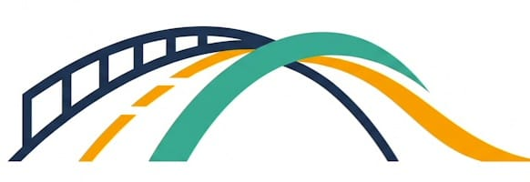
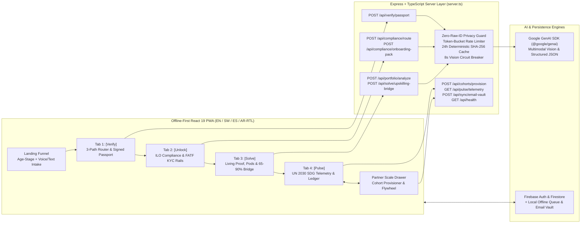

<div align="center">
  

  # Vuka na Amana — Crossing Over

  **Encourage the dream. Acknowledge the skill. Attain the work.**  
  *Turning sidelined talent into active impact.*

  **1+1=3 Agency-First Philosophy:** *Refugee Support + Unapologetic Capability = Agency-First Recognition*

  [Live Demo](https://ais-pre-lz4euvlsocqva2czkkd4og-762996044201.europe-west2.run.app) · [Pitch Deck](#8-90-second-judge-walkthrough) · [Submission Cohort: ILO Mini-Hackathon](#9-acknowledgments--license)
</div>

---

## 1. The Challenge & Vision

Millions of displaced engineers, solar technicians, healthcare operators, craftspeople, and finance specialists are locked out of formal livelihoods by three compounding systemic barriers:
1. **Unrecognized or Missing Paper Credentials:** Forced displacement separates practitioners from physical diplomas, while traditional credential evaluation takes months or requires unreachable issuing institutions.
2. **Legal, Work-Authorization & Banking Friction:** Employers hesitate to hire displaced talent due to perceived compliance complexity, and strict banking KYC blocks cross-border or milestone payouts.
3. **The "Local Experience" & Single-Skill Gap:** Candidates with 65%–90% job readiness are routinely rejected instead of being connected to targeted, short-cycle practical bridges.

**Vuka na Amana — Crossing Over** (*Swahili/Arabic: "Cross Over with Trust"*) replaces charity-framed aid portals with an agency-first, offline-capable **Knowledge-to-Work** pipeline. It guides practitioners across every life stage—from **15–17 Emerging Builders** and **18–29 Rising Practitioners** to **30–45 Specialist Leads** and **46+ Master Advisors**—through paperless competency verification, compliant contracting and tiered-KYC payout rails, demand-driven upskilling pods, and verifiable UN 2030 SDG impact.

---

## 2. Architecture & 5-Benchmark Alignment

| Hackathon Evaluation Benchmark | Implemented UI Flow & Server Route | Grounded Global Frameworks & 1+1=3 Mechanics |
| :--- | :--- | :--- |
| **1. Credential & Skills Verification**<br>*(SDGs 4 & 8)* | **Tab 1 — `[Verify]`**<br>`src/components/VerifyView.tsx`<br>`POST /api/verify/passport` | **Adaptive 3-Path Router:** Foreign/partial credentials (**WES Gateway / ENIC-NARIC**), paperless oral/scenario defense (**UNESCO Qualifications Passport — UQP**), and hands-on trade portfolios (**ILO / KNQA Recognition of Prior Learning — RPL**). Produces an HMAC-SHA256 server-signed **Living Competency Passport** (`VNA-2026-XXXX-XXXX`) with offline QR verification, 4-Tier Trust Ladder, and partner fee-waiver/stipend activation. |
| **2. Access & Compliance Readiness**<br>*(SDGs 8, 10 & 16)* | **Tab 2 — `[Unlock]`**<br>*Compliance Readiness: Crossing Over Access*<br>`src/components/ComplianceCrossingSection.tsx`<br>`POST /api/compliance/route`<br>`POST /api/compliance/onboarding-pack` | **ILO Guiding Principles** jurisdiction router (`Enabling`, `Mixed — Friction Guided`, `Restricted — Remote/EOR Route Active`), **UNHCR / FATF Risk-Based Tiered KYC** payout rails (Mobile Money, Humanitarian Aid Cards, SACCOs, EOR Fiscal Hosts), **Zero-Raw-ID Privacy Mode**, and 1-click **Hiring Partner Compliant Onboarding Packs** with downloadable PDF payout receipts. |
| **3. Practical & Market Fit**<br>*(SDGs 8, 10 & 17)* | **Tab 3 — `[Solve]`**<br>`src/components/LivingProofPortfolioSection.tsx`<br>`src/components/MatchedWorkSection.tsx`<br>`POST /api/portfolio/analyze`<br>`POST /api/solve/upskilling-bridge` | Relatable local & remote skill tracks, client-compressed **Gemini Vision** photo proof + 30-second voice walkthroughs, **Demand-Driven Job-to-Fit Upskilling Bridges** (closing 65%–90% fit gaps via 3–7 day fee-waived TVET/RPL micro-bridges or **ILO Upgraded Apprenticeships**), and **Cross-Age Solution Sprints** pairing 15–29 youth with 30–46+ Master Mentors. |
| **4. Social & SDG Impact**<br>*(SDGs 4, 8, 10, 16 & 17)* | **Tab 4 — `[Pulse]`**<br>`src/components/PulseView.tsx`<br>`GET /api/pulse/telemetry`<br>`POST /api/pulse/events` | Reactive **UN 2030 Agenda Impact Dashboard** tracking live, disaggregated outcomes across **SDG 4** (Targets 4.4 & 4.5), **SDG 8** (Targets 8.5, 8.8 & 8.10), **SDG 10** (Targets 10.2 & 10.7), **SDG 16** (Targets 16.6 & 16.9), and **SDG 17** (Target 17.17), complete with a 4-stage Knowledge-to-Work funnel, Age & Social Cohesion strip, and Hiring Partner feedback loop. |
| **5. Sustainability & Scalability** | **Partner & Scale Mode Drawer**<br>`src/components/PartnerScaleDrawer.tsx`<br>`src/utils/serverArchitecture.ts`<br>`POST /api/cohorts/provision`<br>`GET /api/health` | **Multi-Tenant Cohort Provisioner** (`Country + Sector + Language` JSON blueprint switching with zero code changes), **Peer-Assessor Graduation Flywheel** (verified 30–46+ specialists auditing incoming cohorts to cut manual QA overhead), 24h deterministic compliance hash caching (`<30ms`), token-bucket rate limiting, and 8-second circuit-breaker fallbacks. |

---

## 3. System Flow Diagram



---

## 4. Stability, Privacy & Security by Design

- **Server-Side API Key Protection:** `GEMINI_API_KEY` is consumed exclusively inside `server.ts` via `@google/genai` and is never exposed to client bundles.
- **Deterministic 24-Hour Compliance Hash Caching (`DeterministicComplianceCache`):** Repeated `country + docTier + workMode` compliance lookups are hashed with SHA-256 and served from memory in `<30ms` without burning AI quota.
- **Token-Bucket Rate Limiter (`TokenBucketRateLimiter`):** Protects AI endpoints from burst traffic spikes while returning calm, deterministic RPL/ILO fallbacks with `retryAfterSeconds` metadata.
- **8-Second Vision Circuit Breaker (`VisionCircuitBreaker`):** Wraps multimodal photo-proof analysis (`/api/portfolio/analyze` and `/api/solve/proof-portfolio`) so upstream latency or peak RPM trips cleanly to grounded craft assessments.
- **Client-Side Image Compression for Low-Bandwidth Field Networks:** Work-sample photos in `src/components/LivingProofPortfolioSection.tsx` are downscaled in-browser via HTML5 `<canvas>` (`image/jpeg`, max 900px dimension) before upload.
- **Zero-Raw-ID Refugee Data Protection (`enforceRefugeePrivacyGuard`):** Never stores raw national ID serials, passport numbers, or unencrypted identity scans—retaining only verified tier flags (`refugee-id`, `unhcr-certificate`, `temp-protection`, `national-id`) and issuing consent-scoped employer sharing tokens (`VNA-CONSENT-XXXX`).
- **Dual Offline PWA + Sovereign Email Vault Sync:** Combines `vite-plugin-pwa` service worker caching, local mutation queuing (`src/utils/offlineStore.ts`), Firebase Firestore (`firestore.rules`), and a zero-raw-ID Email Vault (`/api/sync/email-vault`) supporting Gmail, Outlook/Hotmail, Yahoo, and NGO emails.

---

## 5. Tech Stack & Project Structure

### Tech Stack (Verified from `package.json`)
- **Frontend:** React `^19.0.1`, React DOM `^19.0.1`, TypeScript `^7.0.2`, Vite `^8.3.0` (`@vitejs/plugin-react`)
- **Styling & Motion:** Tailwind CSS `^4.3.3` (`@tailwindcss/vite`), Motion (`motion/react` `^12.23.24`), Lucide React `^0.546.0`
- **Backend & AI SDK:** Node.js / Express `^4.21.2`, `tsx` `^4.21.0`, Google GenAI SDK (`@google/genai` `^2.4.0`), `dotenv` `^17.2.3`
- **Persistence, Offline PWA & Verification:** Firebase `^13.4.0` (Auth & Firestore), `vite-plugin-pwa` `^2.0.0`, `qrcode` `^1.5.4`

### Directory Structure
```text
.
├── public/
│   ├── bridge.jpeg                          # Official Vuka na Amana Bridge Emblem
│   ├── icon.svg                             # App vector icon
│   └── pwa-192x192.png / pwa-512x512.png    # Installable PWA icons
├── src/
│   ├── App.tsx                              # Stateful 4-tab studio, offline queue & email/cloud sync
│   ├── main.tsx                             # React root + PWA service worker registration
│   ├── components/
│   │   ├── LandingFunnel.tsx                # 3-section intake funnel with bidirectional Up/Down arrows
│   │   ├── TopNav.tsx                       # 3-zone header bar + mobile thumb-zone navigation
│   │   ├── VerifyView.tsx                   # Tab 1 [Verify]: 3-path router & Living Competency Passport
│   │   ├── UnlockView.tsx                   # Tab 2 [Unlock]: Work-Ready Vault & partner brief board
│   │   ├── ComplianceCrossingSection.tsx    # ILO Work-Auth Router, FATF KYC Rails & Employer Shield
│   │   ├── SolveView.tsx                    # Tab 3 [Solve]: Sprints, milestones & pod mentor workbench
│   │   ├── LivingProofPortfolioSection.tsx  # Client-compressed photo proof & voice walkthroughs
│   │   ├── MatchedWorkSection.tsx           # Local/Remote matched roles & 65%-90% Upskilling Bridge
│   │   ├── PulseView.tsx                    # Tab 4 [Pulse]: UN 2030 Agenda 5-SDG dashboard & ledger
│   │   ├── PartnerScaleDrawer.tsx           # Multi-Tenant Cohort Provisioner & Peer-Assessor Flywheel
│   │   ├── PwaOfflineSyncButton.tsx         # Dedicated PWA offline queue & install control
│   │   ├── AccountSyncModal.tsx             # Multi-provider OAuth + Zero-Raw-ID Email Data Vault
│   │   ├── FaqsAndPlatformGuide.tsx         # Collapsible platform guide & compliance/RPL FAQs
│   │   └── CommandPalette.tsx               # Global Cmd+K / Ctrl+K quick-action palette
│   ├── contexts/
│   │   └── MessagingContext.tsx             # Cross-age pod mentor messaging provider
│   ├── hooks/
│   │   ├── useOnlineStatus.ts               # Real-time connectivity detector
│   │   └── useSpeechInput.ts                # Web Speech API multilingual voice dictation hook
│   ├── lib/
│   │   └── firebase.ts                      # Firebase Auth & Firestore cloud workspace adapters
│   ├── types/
│   │   └── kora.ts                          # Strict TypeScript domain contracts
│   └── utils/
│       ├── serverArchitecture.ts            # HMAC passport signer, 24h cache, circuit breaker & ledger
│       ├── talentEngine.ts                  # Pure domain logic, RPL/ILO presets & PDF receipt builder
│       ├── offlineStore.ts                  # LocalStorage offline queue & compaction engine
│       ├── i18n.ts                          # EN, SW, ES & AR (RTL) translations
│       ├── talentEngine.test.ts             # Domain & server architecture unit test suite
│       └── i18n.test.ts                     # Multilingual & RTL parity unit tests
├── server.ts                                # Express server + /api/* routes + Vite middleware
├── firestore.rules                          # Firebase Firestore security rules
├── BuildHistory.md                          # Chronological engineering milestone log
└── package.json                             # Dependencies and npm scripts
```

---

## 6. Getting Started (Local Setup)

### 1. Install Dependencies
```bash
npm install
```

### 2. Configure Environment Variables
Copy `.env.example` to `.env.local` (or `.env`) in the project root and provide your Gemini API key:
```dotenv
GEMINI_API_KEY="your_key_here"
APP_URL="http://localhost:3000"
```

### 3. Run Development Server, Tests & Production Build
```bash
# Start full-stack Express + Vite server on http://localhost:3000
npm run dev

# Run TypeScript typecheck
npm run lint

# Run the unit test suite (37 tests covering i18n, talentEngine, and serverArchitecture)
npx tsx --test src/utils/i18n.test.ts src/utils/talentEngine.test.ts

# Build production client bundle and start production server
npm run build
npm run start
```

---

## 7. 90-Second Judge Walkthrough

1. **0:00–0:15 · Landing Funnel & Bidirectional Crossing (`LandingFunnel.tsx`):**  
   Select an age track (e.g., `30–45 Specialist` or `18–29 Rising Builder`), test the toggleable **Up/Down** directional arrow units between the three funnel sections, enter or dictate a problem statement, and click **Begin Your Crossing**.
2. **0:15–0:35 · Tab 1 `[Verify]` — Paperless Passport & Offline QR (`VerifyView.tsx`):**  
   Choose one of the 3 verification pathways (Foreign Credentials, Paperless UQP Defense, or Hands-On RPL), generate a server-signed **Living Competency Passport** (`VNA-2026-XXXX-XXXX`), activate the **Partner Fee-Waiver / Stipend** toggle, and click **Share Passport** to inspect the offline-scannable QR code.
3. **0:35–0:55 · Tab 2 `[Unlock]` — ILO Compliance, FATF KYC & Employer Shield (`UnlockView.tsx`):**  
   In *Compliance Readiness: Crossing Over Access*, select a Host Country and Document Tier to view `<30ms` cached ILO pathways and FATF Tiered KYC payout rails. Toggle to **[Hiring Partner Compliance View]** to inspect the **Zero-Friction Onboarding Dossier**, generate a **1-Page Sprint & Compliance Agreement**, and download a compliant **PDF Payout Receipt**.
4. **0:55–1:15 · Tab 3 `[Solve]` — Living Proof Portfolio & 65%–90% Upskilling Bridge (`SolveView.tsx`):**  
   Load a one-click sample work photo (*Solar Panel Wiring Job* or *SME Inventory Dashboard*) and click **Build Employer-Ready Proof**. Below in *Matched Work & Cross-Age Solution Flows*, open a 65%–90% fit role's **Close the Final Gap** Upskilling Bridge to lock in an **ILO Upgraded Apprenticeship Pod** or **3–7 Day TVET/RPL Micro-Bridge**.
5. **1:15–1:30 · Tab 4 `[Pulse]` & Partner Scale Engine (`PulseView.tsx` & `PartnerScaleDrawer.tsx`):**  
   Review the 5 live **UN 2030 SDG Pulse Cards**, the **4-Stage Knowledge-to-Work Flow**, and the **Sprint Performance** sparkline. Click **Scale** in the top bar to open **Partner & Scale Mode**, verify the **Live System Health & Trust Strip** (`/api/health`), and provision a new multi-tenant cohort (`POST /api/cohorts/provision`).

---

## 8. Acknowledgments & License

- **Initiative:** Built for the **Power Learn Project (PLP) & International Labour Organization (ILO) Mini-Hackathon** — *"Unlocking Displaced Talent: Pathways for Skilled Refugees"*.
- **Research & Standards Grounding:** Aligned with the **ILO Guiding Principles on the Access of Refugees and Other Forcibly Displaced Persons to the Labour Market**, **UNESCO Qualifications Passport (UQP)**, **ILO Recognition of Prior Learning (RPL)**, **UNHCR Financial Inclusion**, **FATF Risk-Based Tiered KYC**, and the **UN 2030 Sustainable Development Goals (SDGs 4, 8, 10, 16 & 17)**.
- **License:** Released under the [MIT License](https://opensource.org/licenses/MIT).
